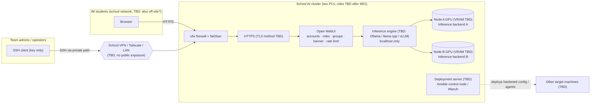

# School AI Server

> **Status: Planning. Nothing is installed yet.**
> This repository holds the plan, documentation and example configuration for the school AI server. No hardware has been inspected, nothing has been installed, configured or tested yet. Every value marked `TBD` is still unknown.

**Prosjekt 09 — AI-server setup** · Subject: *Drift og Utvikling* · Team: max 3 students · Tags: Linux, AI, Sikkerhet, Infrastruktur, Nettverk

📋 **Project board:** [AI Server — Development](https://github.com/users/ganya002/projects/5)

Agents working in this repository: start with [AGENTS.md](AGENTS.md).

---

## The assignment

> **Få AI-serveren opp å kjøre! Tilgjengelig for IM-elever.**

Tasks from the assignment:

1. Install the operating system.
2. Make the server reachable through remote access.
3. Set the system up to act as a **Deployment Server** in security (*sikkerhet*). What exactly this means is being clarified with the teacher (see [docs/deployment-server.md](docs/deployment-server.md)).
4. Set the system up as an **AI host**.
5. Set up **users with the correct access** (different users and roles).

The server can be a physical machine or a VM that is controlled through remote access. AI models need a lot of RAM and preferably a GPU.

## Goal

Run a local model for IM students through a web interface (and, for permitted users, an API), on **two school PCs** (Node A and Node B), without exposing anything to the public internet. How the two nodes talk is in [docs/two-node-cluster.md](docs/two-node-cluster.md).

**Model: TBD** (see [docs/model-selection.md](docs/model-selection.md)).

| Item | Plan | Status |
| --- | --- | --- |
| Model | TBD (see [docs/model-selection.md](docs/model-selection.md)) | Not chosen yet (M02), after the GPU is inventoried (M01) |
| Quantization | TBD, depends on the GPU's VRAM | M03 |
| Hardware | Two PCs: **Node A** (Gabby / DeepSeek) and **Node B** (Gabby's friend / Claude) | CPU / RAM / GPU / VRAM / disk per node: **TBD** (M01) |
| Physical or VM | Bare-metal Ubuntu or Ubuntu VM on Proxmox with GPU passthrough | TBD (ADR, M03) |
| OS | Ubuntu Server LTS | Version TBD (ADR, M03) |
| Inference engine | Ollama, llama.cpp server or vLLM | TBD (ADR, M03) |
| Web UI | Open WebUI (accounts, roles, groups) | Planned |
| Remote access | SSH key-only via school VPN / Tailscale / LAN only. No public exposure | Method TBD (ADR, M03) |
| Deployment Server | Most plausible: Ansible deployment of hardened configs + Wazuh agent deployment | **Waiting for teacher's clarification** (M03) |

## Planned architecture



## Repository structure

```text
.
├── README.md                 This file
├── AGENTS.md                 Guide for coding agents (and humans) working in this repo
├── CLAUDE.md                 Short pointer to AGENTS.md for Claude on Node B
├── CONTRIBUTING.md           How the team works (board, branches, what may be committed)
├── .gitignore                Blocks secrets, .env, model weights (*.gguf, *.safetensors) and databases
├── docs/                     Documentation per area (see table below)
├── decisions/                Architecture Decision Records (ADRs) + template
├── inventory/                Hardware, network and Proxmox inventory templates (no secrets)
├── config/                   Example configs with placeholders only (ssh, ufw, fail2ban, sudoers, engine, web UI)
├── deployment/ansible/       Deployment-server material (example inventory, roles go here)
├── scripts/
│   ├── linux/                collect-hardware-inventory.sh (read-only)
│   ├── benchmark/            bench_openai.py (tokens/sec against an OpenAI-compatible API)
│   └── check-secrets.sh      Scan a diff for secrets and real IPs before you push
├── benchmarks/               Methodology, prompts and (real) results
├── assets/diagrams/          Exported diagrams
└── .github/                  Issue and pull request templates
```

## Documentation

| Topic | Document |
| --- | --- |
| Architecture | [docs/architecture.md](docs/architecture.md) |
| Two-node cluster | [docs/two-node-cluster.md](docs/two-node-cluster.md) |
| Acceptable use policy | [docs/acceptable-use-policy.md](docs/acceptable-use-policy.md) |
| Model selection & quantization | [docs/model-selection.md](docs/model-selection.md) |
| OS installation | [docs/os-installation.md](docs/os-installation.md) |
| Network & port matrix | [docs/network.md](docs/network.md) |
| Remote access | [docs/remote-access.md](docs/remote-access.md) |
| Security hardening | [docs/security-hardening.md](docs/security-hardening.md) |
| Users & roles | [docs/users-and-roles.md](docs/users-and-roles.md) |
| GPU & drivers | [docs/gpu-drivers.md](docs/gpu-drivers.md) |
| AI host (inference engine) | [docs/ai-host.md](docs/ai-host.md) |
| Web UI & API | [docs/web-ui-and-api.md](docs/web-ui-and-api.md) |
| Deployment Server (sikkerhet) | [docs/deployment-server.md](docs/deployment-server.md) |
| Operations | [docs/operations.md](docs/operations.md) |
| Backup & restore | [docs/backup.md](docs/backup.md) |
| Benchmarking (tokens/sec) | [docs/benchmarking.md](docs/benchmarking.md) · [methodology](benchmarks/methodology.md) |
| Troubleshooting | [docs/troubleshooting.md](docs/troubleshooting.md) |
| Student guide | [docs/student-user-guide.md](docs/student-user-guide.md) |
| Acceptance checklist | [docs/acceptance-checklist.md](docs/acceptance-checklist.md) |
| Test results | [docs/testing-results.md](docs/testing-results.md) |
| Decisions (ADRs) | [decisions/README.md](decisions/README.md) |

## Current project status

| Milestone | Status |
| --- | --- |
| M01 — Discovery & Inventory | Ready to start |
| M02 — Approval & Policy | Not started |
| M03 — Architecture & Design | Not started |
| M04 — OS Installation | Not started |
| M05 — Remote Access | Not started |
| M06 — Security Hardening | Not started |
| M07 — Users & Access | Not started |
| M08 — GPU & Drivers | Not started |
| M09 — AI Host | Not started |
| M10 — Web UI & API | Not started |
| M11 — Deployment Server (Sikkerhet) | Not started (waiting for clarification) |
| M12 — Testing | Not started |
| M13 — Benchmarking | Not started |
| M14 — Documentation & Handover | Not started |
| M15 — Node Interconnect | Not started (after both nodes have OS + AI host) |

Work is tracked on the [project board](https://github.com/users/ganya002/projects/5). Start with the **Ready** column.

## Important prerequisites

Nothing is installed until these are in place. Each has its own issue:

- Written permission from the teacher and school IT to use and reinstall the machine (M01).
- A written decision on which model to run, after it is checked against the criteria in [docs/model-selection.md](docs/model-selection.md) (M02).
- An approved acceptable use policy, logging decision and retention period (M02).
- The teacher's clarification of what "Deployment Server" means in this assignment (M03).
- An approved remote-access method. **The server is never exposed to the public internet.**

## Project team

The assignment allows **at most 3 students**. Each task on the board is sized for one person (15–90 minutes); split work so the three of you can work in parallel and review each other.

| Role | Name | Main area |
| --- | --- | --- |
| Responsible teacher | TBD | Approval, assessment |
| School IT contact | TBD | Network, accounts, security approval |
| Student 1 (Node A) | Gabby | Node A owner; DeepSeek is the coding agent |
| Student 2 (Node B) | Gabby's friend | Node B owner; Claude is the coding agent |
| Student 3 | TBD | TBD (shared docs, policy, web UI — if a third member joins) |

## Licence

No licence has been chosen. This repository is **public**. Never commit secrets, passwords, real IP addresses, hostnames, MAC addresses, student names or other school-internal details.
